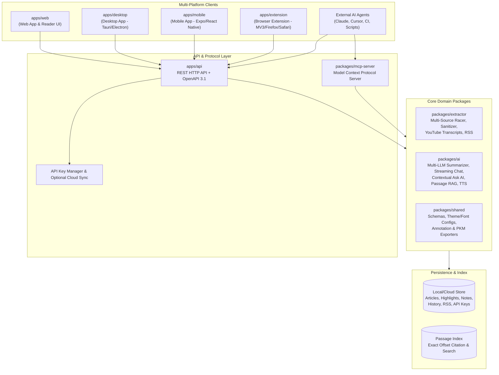
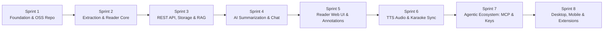

# Summary AI — Open-Source Agentic Reading, Summarizing & Research Platform

> [!NOTE]
> **Project Vision:** Patterned after [smry.ai](https://smry.ai), **Summary AI** is an open-source, privacy-respecting, agent-native reading, summarization, and research platform across **Web**, **Desktop**, **Mobile**, **Browser Extensions**, **REST OpenAPI**, and **Model Context Protocol (MCP)**. Users can paste any article, book, website, or YouTube URL with **no account required**, read without distractions or soft paywalls, summarize and chat with top LLMs, listen with karaoke-synced TTS, annotate and export to PKM tools, and connect external AI agents via API keys and MCP.

---

## 1. System Architecture Overview

---

## 2. Complete Prioritized List of Features & Requirements
*(Sorted strictly from **Most Fundamental [Rank 1]** to **Least Fundamental [Rank 28]**)*

| Rank | Feature / Requirement | Category | Why It Has This Priority |
| :--- | :--- | :--- | :--- |
| **1** | **Monorepo Architecture, Shared Schemas & OSS Governance** | Foundation | Defines canonical data contracts (`Article`, `Highlight`, `Summary`, `ChatMessage`, `ApiKey`, `RssFeed`), workspace build pipeline, CI/CD, and open-source community standards. |
| **2** | **Distraction-Free HTML Sanitizer & Article Parser** | Content Extraction | Core value proposition: strips popups, ads, cookie banners, newsletter modals, and soft paywall overlays into clean semantic content. |
| **3** | **Automatic Multi-Source Selection & Racing Engine** | Content Extraction | Races Direct Fetch, Wayback Machine, Google Cache, and Archive mirrors in parallel, scoring completeness to return the most unblocked version. |
| **4** | **Copy to LLMs (Clean Markdown Exporter)** | Content Extraction | Converts extracted DOM into clean, structured Markdown with metadata headers ready for one-click pasting into ChatGPT, Claude, or Gemini. |
| **5** | **No-Account-Required Instant URL Access** | Platform & Core UX | Zero-friction entry point: users can submit any URL and immediately read, summarize, and annotate without mandatory sign-up. |
| **6** | **Distraction-Free Reader UI & Typography Customization** | Reader Mode | Renders extracted content with Dark/Light/Sepia modes, adjustable font size, line spacing, margins, and **7 reader fonts** (including **OpenDyslexic**). |
| **7** | **Core REST HTTP API & OpenAPI 3.1 Specification** | Platform & API | Unified backend interface serving Web, Desktop, Mobile, Extensions, `curl`, and CI—fully described by an interactive OpenAPI 3.1 spec. |
| **8** | **Persistent Library, Reading History & Filing System** | Knowledge Mgmt | Saves articles, books, and websites locally/cloud with tags, reading progress, and automatic filing for future retrieval. |
| **9** | **Multi-Provider AI Model Selection (Claude, GPT, Gemini, Local)** | AI & Summarization | Pluggable LLM router supporting Anthropic Claude, OpenAI GPT, Google Gemini, and local/fallback engines. |
| **10** | **Customizable AI Summaries** | AI & Summarization | Generates Executive TL;DRs, Concise Bullet Points, Key Takeaways, or summaries driven by custom user prompts. |
| **11** | **Streaming AI Chat on Loaded Content** | AI & Summarization | Interactive conversational panel with real-time word-by-word SSE streaming grounded in the active article. |
| **12** | **Exact-Passage Question Answering (Library RAG)** | AI & Research | Answers questions across saved articles/books and returns the **exact source passage and character offsets** verifying the answer. |
| **13** | **Contextual "Ask AI" on Highlighted Excerpts** | AI & Summarization | Highlighting any passage triggers targeted AI explanations, definitions, critiques, or custom Q&A scoped specifically to that excerpt. |
| **14** | **Multi-Color Highlights & Personal Margin Notes** | Annotations | Marks up text passages using 5 distinct color tags with attached personal margin notes anchored to passage offsets. |
| **15** | **Annotations Sidebar Drawer & Color/Text Filter** | Annotations | Dedicated drawer to search annotations, filter by color tag, and jump directly to the highlighted passage in the reader. |
| **16** | **PKM & Note-Taking App Exports** | Knowledge Mgmt | One-click export of structured highlights, citations, and notes to **Notion**, **Obsidian**, **Roam Research**, **Markdown**, or **JSON**. |
| **17** | **YouTube Video Transcript Extraction & Reader** | Content Extraction | Extracts timed transcripts from YouTube URLs into readable, summarizable, and searchable sections. |
| **18** | **API Key Creation, Scoping & Revocation** | Agent & Security | Create, list, and revoke bearer credentials (`smry_...`) for external agents, CLI scripts, and CI pipelines. |
| **19** | **Model Context Protocol (MCP) Server** | Agent Integration | Exposes tools and resources so external AI agents can programmatically extract URLs, summarize, search library passages, and manage RSS. |
| **20** | **Natural Voice TTS Engine (10 Voices & Accents)** | Audio & TTS | Synthesizes articles into natural audio across 10 distinct male/female voices and regional accents. |
| **21** | **Karaoke-Style Word-by-Word Audio Highlighting** | Audio & TTS | Synchronizes word-level timestamps with audio playback for real-time visual highlighting and click-any-word timestamp seeking. |
| **22** | **Floating Audio Player & Playback Controls** | Audio & TTS | Persistent mini-player with 0.5x–2x playback speed control, play/pause, progress scrubber, and ±10s skip buttons. |
| **23** | **RSS & Atom Feed Subscription & Auto-Ingestion** | Agent & Research | Subscribe to feeds so new articles are automatically extracted, summarized, and filed for the user and connected agents. |
| **24** | **Cross-Device Cloud Sync** | Platform & Sync | Synchronizes saved articles, reading history, highlight states, margin notes, and chat threads across devices. |
| **25** | **Browser Extensions (Chrome, Edge, Opera, Firefox, Safari)** | Platform Clients | One-click toolbar extension and context menu to open the active tab in Summary AI or save directly to the library. |
| **26** | **Cross-Platform Desktop Application** | Platform Clients | Native desktop app shell (Tauri/Electron) with offline library access, local MCP server hosting, and system shortcuts. |
| **27** | **Cross-Platform Mobile Application (iOS & Android)** | Platform Clients | Mobile app (React Native / Expo) with adaptive reader typography, background TTS playback, and OS share-sheet integration. |
| **28** | **Book / Long-Form Document Ingestion & Batch CI Workflows** | Advanced Research | Multi-chapter book/document chunking, batch URL summarization endpoints, and community plugin hooks. |

---

## 3. Phased Development Sprints
*(Collated and organized by Software Engineering Core Practices)*

### Sprint 1: Architecture, Monorepo Foundation & Open-Source Governance
* **Core Practice:** *Domain-Driven Design (DDD), Type-Safe Contracts, & Open-Source Hygiene*
* **Scope (Features #1):**
  * Initialize Git repository and `pnpm` monorepo workspace (`packages/*`, `apps/*`).
  * Create `packages/shared` with strict TypeScript interfaces and runtime validation schemas for Articles, Sources, ReaderSettings (7 fonts including OpenDyslexic), Highlights, Notes, ChatThreads, Summaries, TTS Timestamps, API Keys, and RSS Feeds.
  * Establish gold-standard open-source governance: `README.md`, `LICENSE` (MIT), `CONTRIBUTING.md`, `CODE_OF_CONDUCT.md`, `SECURITY.md`, GitHub Actions CI workflow (`.github/workflows/ci.yml`), and Issue/PR templates.
* **Definition of Done:** Workspace builds cleanly, lints pass, and shared schema unit tests pass.

### Sprint 2: Content Extraction Engine, Multi-Source Racer & Markdown/YouTube Parsers
* **Core Practice:** *Resilient I/O, Defensive Parsing, & Test-Driven Development (TDD)*
* **Scope (Features #2, #3, #4, #17):**
  * Build `packages/extractor`:
    * **Distraction-Free Sanitizer:** Removes scripts, ad containers, popups, cookie banners, newsletter modals, and soft-paywall overlays (`overflow:hidden` locks, paywall classes, inline blur styles).
    * **Automatic Source Selection (Racer):** Concurrently queries Direct Fetch, Wayback Machine (`archive.org`), Google Cache / Archive mirrors, and scores candidate responses by content length, paragraph density, and paywall absence.
    * **Copy to LLMs:** Converts cleaned HTML/DOM into structured Markdown with title, author, canonical URL, and LLM-ready framing.
    * **YouTube Transcript Extractor:** Detects `youtube.com` / `youtu.be` URLs, extracts caption tracks and timestamps, and formats readable transcript blocks.
* **Definition of Done:** Comprehensive unit test suite verifying paywall/ad stripping, multi-source racing fallback, Markdown formatting, and YouTube transcript parsing.

### Sprint 3: Core REST API, OpenAPI 3.1 Spec, Library Persistence & Exact-Passage RAG
* **Core Practice:** *API-First Design, Separation of Concerns, & Information Retrieval*
* **Scope (Features #5, #7, #8, #12, #23, #24):**
  * Build `apps/api` and storage layer:
    * Zero-account instant endpoints (`POST /api/v1/extract`, `POST /api/v1/summarize`) plus persistent library CRUD (`/api/v1/articles`, `/api/v1/history`, `/api/v1/sync`).
    * **Exact-Passage Retrieval Engine:** Indexes saved articles/books into overlapping passage chunks with exact character start/end offsets; answers later user/agent queries with the exact cited passage.
    * **RSS Feed Engine:** Subscribe, poll, extract, and auto-file RSS/Atom feed items (`/api/v1/feeds`).
    * Auto-generated **OpenAPI 3.1** specification (`GET /openapi.json`) and interactive documentation UI (`GET /docs`).
* **Definition of Done:** API integration tests verifying extraction, library filing, exact-passage search citations, RSS ingestion, and OpenAPI schema validity.

### Sprint 4: Multi-LLM AI Summarization, Streaming Chat & Contextual "Ask AI"
* **Core Practice:** *Adapter Pattern, Streaming Architecture, & Graceful Degradation*
* **Scope (Features #9, #10, #11, #13):**
  * Build `packages/ai`:
    * Unified LLM provider adapter supporting **Claude** (Anthropic), **GPT** (OpenAI), **Gemini** (Google), and a built-in deterministic extractive fallback so local/keyless installs work immediately.
    * **Customizable Summaries:** `tldr`, `bullets`, `executive`, `takeaways`, and `custom` prompt templates.
    * **Streaming AI Chat:** Server-Sent Events (SSE) word-by-word streaming chat grounded in the article context.
    * **Contextual "Ask AI":** Scoped prompt execution on a user-highlighted passage (`explain`, `define`, `summarize`, `critique`, or freeform question).
* **Definition of Done:** Streaming and non-streaming tests across all summary modes, model selectors, and contextual passage queries.

### Sprint 5: Distraction-Free Reader Web App, Multi-Color Annotations & PKM Exports
* **Core Practice:** *Accessible UI Engineering (WCAG), Reactive State, & Interoperability*
* **Scope (Features #6, #14, #15, #16):**
  * Build `apps/web` (smry.ai-patterned interface):
    * **No-Account Instant Reader:** Paste any URL, YouTube link, or text; inspect source racing telemetry and switch sources anytime.
    * **Reader Customization:** Dark, Light, and Sepia themes; sliders for font size, line height, and page margins; **7 reader fonts** (`Inter`, `Georgia`, `Merriweather`, `Lora`, `JetBrains Mono`, `Atkinson Hyperlegible`, `OpenDyslexic`).
    * **Multi-Color Highlights & Margin Notes:** Text selection popover with 5 highlight colors, personal note attachment, and contextual "Ask AI".
    * **Annotations Sidebar & PKM Export:** Search/filter annotations by color or keyword, click to scroll to passage, and one-click export to **Notion**, **Obsidian**, **Roam Research**, **Markdown**, and **JSON**.
* **Definition of Done:** Full Web UI functional verification and export format unit tests.

### Sprint 6: Natural Voice TTS Engine, Karaoke Word Sync & Floating Audio Player
* **Core Practice:** *Real-Time Media Synchronization & Progressive Enhancement*
* **Scope (Features #20, #21, #22):**
  * Build TTS & Karaoke module in `packages/ai` and `apps/web`:
    * **10 Natural Voice Profiles:** Male/female voices across US, UK, AU, IN, and EU accents with server synthesis + Web Speech API integration.
    * **Karaoke Word-by-Word Sync:** Generates word-level `[startMs, endMs, charStart, charEnd]` timing maps; highlights the active word in real time during playback and lets users click any word in the article to jump directly to that audio timestamp.
    * **Floating Player:** Adjustable playback speed (`0.5x` to `2.0x`), `±10s` skip controls, voice selector, and progress bar.
* **Definition of Done:** Word-boundary timestamp calculation tests and interactive player synchronization in the Reader UI.

### Sprint 7: Agentic Ecosystem — API Keys, REST Automation & MCP Server
* **Core Practice:** *Security-by-Default, Protocol Compliance, & Agent Ergonomics*
* **Scope (Features #18, #19):**
  * Implement **API Key Management** (`/api/v1/keys`): generate, hash, list, and revoke `smry_live_...` API keys with usage tracking.
  * Build `packages/mcp-server`: Full **Model Context Protocol (MCP)** server exposing tools (`extract_article`, `summarize_content`, `save_article`, `search_library_passages`, `ask_library`, `list_reading_history`, `manage_rss_feeds`) and resources (`library://articles`, `library://history`) for Claude Desktop, Cursor, Antigravity, and custom agents.
* **Definition of Done:** End-to-end tests for API key authentication/revocation and MCP JSON-RPC tool invocation.

### Sprint 8: Multi-Platform Ecosystem — Desktop, Mobile & Browser Extensions
* **Core Practice:** *Cross-Platform Code Reuse & Packaging Automation*
* **Scope (Features #25, #26, #27, #28):**
  * `apps/extension`: Manifest V3 (Chrome, Edge, Opera) & WebExtension (Firefox, Safari) browser extension with popup reader, context-menu "Summarize / Open in Summary AI", and one-click save.
  * `apps/desktop`: Cross-platform Desktop application (Tauri + Electron configuration) bundling the reader UI and local API/MCP daemon.
  * `apps/mobile`: Cross-platform Mobile application (Expo / React Native) with mobile reader typography, TTS player, offline cache, and share-sheet handler.
* **Definition of Done:** All client packages build/validate cleanly and connect to the shared core and REST API.
