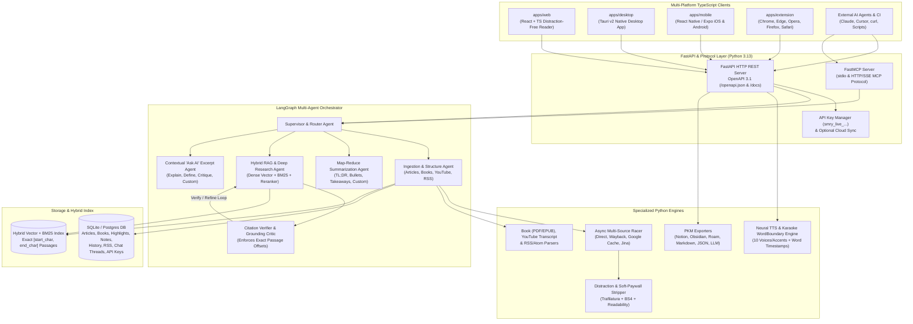

# Summary AI — Full-Scale Agentic AI Reading, Summarizing & Research Platform

> [!IMPORTANT]
> **Architecture Upgrade — Full-Scale Multi-Agent & Polyglot Stack:**
> To build a flagship open-source agentic platform without compromises, **Summary AI** uses a **Python + TypeScript polyglot monorepo**:
> * **Agentic & RAG Backend (`backend/` — Python 3.13 + `uv`)**:
>   * **Multi-Agent Orchestration:** **LangGraph (`langgraph`)** stateful multi-agent graphs with cyclic citation verification, map-reduce book/article summarization, supervisor routing, and `astream_events` token-by-token streaming.
>   * **Multi-LLM Router:** **LangChain / LiteLLM** supporting runtime switching across **Anthropic Claude**, **OpenAI GPT**, **Google Gemini**, **OpenRouter** (`openrouter.ai` — single-key access to DeepSeek, Qwen, Llama, Mistral, Claude, GPT, Gemini, plus live model catalog discovery), and **Local AI** (**Ollama** with live local model auto-discovery at `http://localhost:11434/api/tags`, **LM Studio**, **llama.cpp**, and **vLLM**, including local Ollama embeddings for 100% offline/private RAG).
>   * **Extraction & Document Ingestion:** **`trafilatura`**, **`readability-lxml`**, **`BeautifulSoup4`**, **`httpx` (async mirror racing)**, **`youtube-transcript-api`**, **`PyMuPDF` (`fitz`) & `ebooklib`** (for PDF/EPUB books), and **`feedparser`** (RSS/Atom).
>   * **Hybrid Exact-Passage RAG:** **Chroma / SQLite-vec dense embeddings + `rank-bm25` lexical search + Cross-Encoder Reranking**, indexing every paragraph/chunk with exact `[start_char, end_char, page_or_timestamp]` offsets so questions asked weeks later return the **exact verbatim passage**.
>   * **Neural TTS & Karaoke Word Sync:** **`edge-tts` / Neural Audio synthesizer** streaming real MP3/WebM audio with native **`WordBoundary`** events (`[start_ms, end_ms, char_start, char_end]`) across **10 distinct male/female voices and accents**.
>   * **HTTP REST API & MCP Server:** **FastAPI** (auto-generating the **OpenAPI 3.1** spec at `/openapi.json` & `/docs`) + official **`mcp` (`FastMCP`)** Python server (`stdio` + Streamable HTTP/SSE).
> * **Multi-Platform Clients (`apps/` & `packages/` — TypeScript + `pnpm`)**:
>   * **Web App (`apps/web`):** React + TypeScript + Tailwind CSS distraction-free reader, source-race telemetry bar, 7 reader fonts (including **OpenDyslexic**), 5-color annotation engine, streaming LangGraph chat, and floating Karaoke audio player.
>   * **Desktop App (`apps/desktop`):** **Tauri v2 (Rust + WebView)** native desktop application managing the local Python FastAPI/LangGraph/MCP sidecar, global OS shortcuts, and offline library.
>   * **Mobile App (`apps/mobile`):** **React Native / Expo** (iOS & Android) with native OS Share-Sheet ingestion, offline reader, OpenDyslexic typography, and background Karaoke TTS.
>   * **Browser Extensions (`apps/extension`):** Cross-browser WebExtension (**Chrome, Edge, Opera, Firefox, Safari**) for one-click tab reading, soft-paywall bypass, selection "Ask AI", and library filing.

---

## 1. Multi-Agent LangGraph & System Architecture

---

## 2. Complete Prioritized List of All Features & Requirements
*(Sorted strictly from **Most Fundamental [Rank 1]** to **Least Fundamental [Rank 32]**)*

| Rank | Feature / Requirement | Category | Why It Has This Priority |
| :--- | :--- | :--- | :--- |
| **1** | **Polyglot Monorepo Architecture, Database Models & Open-Source Governance** | Foundation | Establishes the Python (`uv`) + TypeScript (`pnpm`) workspace, SQLAlchemy/SQLite schemas, Docker setup, CI workflows, and open-source community docs. |
| **2** | **Core FastAPI HTTP Server & Auto-Generated OpenAPI 3.1 Spec** | Platform & API | Provides the canonical REST interface (`/openapi.json`, `/docs`) and health/config endpoints that every client, script, and test consumes. |
| **3** | **No-Account-Required Instant Access & Anonymous Session State** | Platform & Core UX | Core smry.ai workflow: users can paste any URL immediately on the web without mandatory sign-up or login barriers. |
| **4** | **Distraction-Free HTML Sanitizer & Soft-Paywall Overlay Stripper** | Content Extraction | Strips popups, advertisements, cookie banners, newsletter modals, scroll locks, and soft paywall overlays using `trafilatura` + `readability` + `BeautifulSoup4`. |
| **5** | **Automatic Multi-Source Racing Engine (`Direct`, `Wayback`, `Google Cache`, `Reader Proxy`)** | Content Extraction | Concurrently races multiple web mirrors via async `httpx`, scores candidate completeness and paywall absence, and selects the most complete unblocked article. |
| **6** | **Copy to LLMs (Clean Structured Markdown Exporter)** | Content Extraction | One-click utility to export the stripped article with metadata headers into clean Markdown ready for ChatGPT, Claude, or Gemini. |
| **7** | **Exact-Offset Passage Chunker & Hybrid Indexer (BM25 + Vector Embeddings)** | RAG & Research | Splits articles, books, and transcripts into semantic passages while preserving exact `[start_char, end_char, paragraph_idx]` offsets for verifiable citations. |
| **8** | **Persistent Library, Reading History & Automatic Filing System** | Knowledge Mgmt | Stores saved articles, books, and websites, tracks chronological reading history, and files items with tags and metadata. |
| **9** | **YouTube Video Transcript Extractor & Timestamped Reader** | Content Extraction | Extracts readable transcripts from YouTube links (`youtube.com`, `youtu.be`, `shorts`) with clickable `[MM:SS]` timestamps for reading and summarizing. |
| **10** | **Book & Long-Form Document Ingestion (PDF, EPUB, Markdown/Text)** | Content Extraction | Parses books and long-form documents into chapters and indexed passages so books are read, summarized, and filed alongside web articles. |
| **11** | **Multi-Provider LLM Router (Claude, GPT, Gemini, OpenRouter & Local AI via Ollama/LM Studio/vLLM)** | AI & Agents | Unified model abstraction allowing instant switching between Anthropic Claude, OpenAI GPT, Google Gemini, **OpenRouter** (any model on `openrouter.ai`), and **Local AI** (**Ollama** with auto-discovered local models & embeddings, LM Studio, llama.cpp, vLLM). |
| **12** | **LangGraph Multi-Agent Foundation & Supervisor State Graph** | AI & Agents | Defines the core LangGraph `StateGraph`, shared agent state, checkpointing, and routing between specialized reading/research agents. |
| **13** | **Customizable AI Summarization Agent (TL;DR, Bullets, Takeaways, Executive, Custom Prompt)** | AI & Summarization | LangGraph summarization workflow supporting single-pass and map-reduce book/article summaries across preset modes or custom user prompts. |
| **14** | **Exact-Passage Library Q&A + Citation Verifier Critic Agent** | AI & Research | *"Ask a question later and get the answer with the exact passage."* Retrieves candidate passages and runs a Critic Agent loop to verify verbatim quotes and character offsets. |
| **15** | **Streaming AI Chat (`text/event-stream` SSE Word-by-Word Streaming)** | AI & Summarization | Interactive conversational panel streaming LangGraph agent tokens and live tool/verification status in real time. |
| **16** | **Contextual "Ask AI" Excerpt Analyst Agent** | AI & Summarization | Highlighting any specific passage in the reader triggers targeted AI explanations, definitions, critiques, or custom Q&A scoped strictly to that excerpt. |
| **17** | **Distraction-Free Web Reader Application (smry.ai-Patterned UI)** | Web Client | React + TypeScript reader interface with instant URL bar, source-race switcher, collapsible AI/Annotations sidebars, and responsive layout. |
| **18** | **Reader Typography & Theme Customization (7 Fonts Including OpenDyslexic)** | Reader Mode | Dark, Light, and Sepia themes; adjustable font size, line spacing, margins, and 7 reader fonts (`Inter`, `Georgia`, `Merriweather`, `Lora`, `JetBrains Mono`, `Atkinson Hyperlegible`, **`OpenDyslexic`**). |
| **19** | **Multi-Color Highlights & Personal Margin Notes Engine** | Annotations | Mark up text passages in 5 semantic colors anchored to exact character offsets and attach personal margin notes. |
| **20** | **Annotations Sidebar Drawer, Search & Color Tag Filter** | Annotations | Dedicated drawer to search highlights/notes by keyword, filter by color tag, and jump straight to the highlighted section in the article. |
| **21** | **One-Click Note-Taking App Exports (Notion, Obsidian, Roam Research, Markdown, JSON)** | Knowledge Mgmt | Exports structured highlights, margin notes, exact citations, and summaries into native formats for Notion, Obsidian, Roam, Markdown, and JSON. |
| **22** | **Natural Voice Neural TTS Engine (10 Distinct Male/Female Voices & Accents)** | Audio & TTS | Converts articles into natural speech across 10 male/female voices and regional accents (US, UK, AU, IN, IE/EU, CA) via `edge-tts` neural synthesis. |
| **23** | **Karaoke-Style Word-by-Word Audio Synchronization** | Audio & TTS | Uses exact word-boundary timestamps (`[start_ms, end_ms, char_start, char_end]`) to highlight words in real time as audio plays and lets users click any word to seek to that timestamp. |
| **24** | **Floating Audio Player & Playback Controls (Up to 2x Speed & ±10s Skip)** | Audio & TTS | Persistent floating player with `0.5x–2.0x` playback speed selector, play/pause, timeline scrubber, voice picker, and `-10s` / `+10s` skip buttons. |
| **25** | **API Key Credentials Management (Create, Scope, Audit & Revoke)** | Agent Security | Create and revoke `smry_live_...` bearer API keys (stored as SHA-256 hashes) so external agents, scripts, `curl`, and CI can authenticate securely. |
| **26** | **RSS & Atom Feed Subscription & Auto-Filing Engine** | Agent & Research | Subscribe to RSS/Atom feeds so new articles are automatically extracted, summarized, indexed, and filed for the user and connected agents. |
| **27** | **Model Context Protocol (MCP) Server (`FastMCP` over stdio & SSE)** | Agent Integration | Exposes full extraction, summarization, reading history, saved library exact-passage search, and RSS management to external AI agents over MCP. |
| **28** | **Cross-Device Cloud Sync Engine** | Platform & Sync | Synchronizes saved articles, books, reading progress, highlight states, margin notes, reader settings, and chat threads across devices. |
| **29** | **Browser Extensions (Chrome, Edge, Opera, Firefox & Safari)** | Platform Clients | Manifest V3 / WebExtension for Chromium, Firefox, and Safari providing one-click active-tab reading, paywall bypass, and library saving. |
| **30** | **Cross-Platform Desktop Application (Tauri v2 Native App)** | Platform Clients | Native desktop app for Linux, macOS, and Windows bundling the Web Reader, local Python FastAPI/LangGraph sidecar, local MCP daemon, and global shortcuts. |
| **31** | **Cross-Platform Mobile Application (React Native / Expo for iOS & Android)** | Platform Clients | Mobile app featuring OS Share-Sheet URL capture, adaptive reader with OpenDyslexic support, offline caching, and background Karaoke TTS player. |
| **32** | **Docker Compose Self-Hosting, CI/CD Pipelines & Community Plugin SDK** | OSS & DevOps | Production `Dockerfile` + `docker-compose.yml`, automated GitHub Actions test suites for Python & TypeScript, and contributor documentation. |

---

## 3. Phased Development Sprints & Review Checkpoints
*(Organized by Software Engineering Core Practices)*

> [!CAUTION]
> **Mandatory Post-Sprint Gate (Strictly Enforced After Every Sprint):**
> I will **never** advance to Sprint $N+1$ until Sprint $N$ completes this 5-step gate with you:
> 1. **Automated Testing:** Run the sprint's `pytest` / TypeScript test suite and show full test results.
> 2. **Live Interactive Demo:** Start the live service and provide concrete interactive commands/URLs so you can conduct your own hands-on testing.
> 3. **Post-Sprint Review Conversation:** Stop and discuss what works, what feels off, and what you want changed.
> 4. **Bug & Adjustment Tracking:** Log every issue, edge case, or refinement you identify as a tracked item (`BUG-xxx` / `ADJ-xxx`) in [bug_and_sprint_tracker.md](file:///home/jason/.gemini/antigravity-cli/brain/f12f97d7-828a-4bcf-b85b-42199da7058a/bug_and_sprint_tracker.md) and `docs/BUG_TRACKER.md`, fix them, and re-verify.
> 5. **Explicit User Sign-Off:** Only move to the next sprint when you explicitly approve.

```mermaid
flowchart LR
    S1["Sprint 1\nPolyglot Repo, DB &\nFastAPI OpenAPI Core"] --> S2["Sprint 2\nMulti-Source Racer,\nSanitizer, YT & Books"]
    S2 --> S3["Sprint 3\nHybrid Vector+BM25 RAG\n& Library Filing"]
    S3 --> S4["Sprint 4\nLangGraph Multi-Agent:\nSummaries, Chat & Critic"]
    S4 --> S5["Sprint 5\nReact Reader UI,\n7 Fonts & Customizer"]
    S5 --> S6["Sprint 6\n5-Color Annotations &\nNotion/Obsidian/Roam"]
    S6 --> S7["Sprint 7\nNeural 10-Voice TTS &\nKaraoke Word Sync"]
    S7 --> S8["Sprint 8\nAgent Hub: API Keys,\nRSS & FastMCP Server"]
    S8 --> S9["Sprint 9\nDesktop (Tauri), Mobile\n(Expo) & Extensions"]
```

### Sprint 1: Polyglot Monorepo Foundation, Database Layer, FastAPI OpenAPI Core & OSS Governance
* **Core Practice:** *Clean Architecture, Schema-First API Design (Pydantic v2 + OpenAPI 3.1), & Open-Source Hygiene*
* **Features Included:** Ranks **#1, #2, #3**
* **Deliverables:**
  * Python 3.13 backend workspace (`backend/`) managed with `uv` (`pyproject.toml`) + TypeScript workspace (`apps/`, `packages/`) managed with `pnpm`.
  * SQLAlchemy / SQLite database engine & Pydantic v2 domain schemas (`Article`, `Book`, `PassageChunk`, `SummaryRecord`, `Annotation`, `ChatThread`, `ChatMessage`, `ApiKey`, `RssFeed`, `SyncState`).
  * FastAPI application (`backend/app/main.py`) with CORS, No-Account-Required anonymous session support, `/api/v1/meta` (7 fonts including OpenDyslexic, 5 highlight colors, 10 neural voices, AI models), and auto-generated **OpenAPI 3.1** specification (`/openapi.json` & `/docs`).
  * Gold-standard open-source governance files (`README.md`, `LICENSE`, `CONTRIBUTING.md`, `CODE_OF_CONDUCT.md`, `SECURITY.md`, `.github/workflows/ci.yml`, `docs/BUG_TRACKER.md`).
* **Post-Sprint Checkpoint:** `pytest` suite on database & FastAPI OpenAPI endpoints + live `curl`/Swagger demo.

### Sprint 2: Async Multi-Source Extraction Racer, Distraction/Paywall Stripper, YouTube Transcripts & Book Parser
* **Core Practice:** *Resilient Async I/O, Defensive DOM Sanitization, & Multi-Format Ingestion*
* **Features Included:** Ranks **#4, #5, #6, #9, #10**
* **Deliverables:**
  * **Distraction-Free Sanitizer (`backend/app/extraction/sanitizer.py`):** Multi-stage extraction using `trafilatura`, `readability-lxml`, and `BeautifulSoup4` to strip popups, ads, cookie banners, newsletter modals, and soft paywall overlays.
  * **Async Multi-Source Racer (`backend/app/extraction/racer.py`):** Concurrently races Direct Fetch, Wayback Machine (`archive.org`), Google Cache / Archive mirrors, and Jina Reader proxy via `httpx.AsyncClient`, scoring completeness and paywall absence.
  * **Copy to LLMs (`backend/app/extraction/markdown_exporter.py`):** Clean, structured Markdown conversion with metadata headers.
  * **YouTube Transcript Extractor (`backend/app/extraction/youtube.py`):** Uses `youtube-transcript-api` + watch-page parser to extract timestamped `[MM:SS]` transcripts.
  * **Book & Document Parser (`backend/app/extraction/books.py`):** Parses PDF (`PyMuPDF`), EPUB (`ebooklib`), and Markdown/Text books into structured chapters and paragraphs.
* **Post-Sprint Checkpoint:** `pytest` extraction benchmark suite + live demo extracting articles, paywalled mirrors, YouTube transcripts, and PDF/EPUB books.

### Sprint 3: Exact-Offset Passage Indexer, Hybrid RAG (Vector + BM25) & Persistent Library Filing
* **Core Practice:** *Information Retrieval Engineering & Deterministic Citation Indexing*
* **Features Included:** Ranks **#7, #8, #28**
* **Deliverables:**
  * **Exact-Offset Passage Chunker (`backend/app/rag/chunker.py`):** Splits documents into semantic passages while recording exact `start_char`, `end_char`, `paragraph_index`, and `chapter_or_timestamp`.
  * **Hybrid Retriever (`backend/app/rag/retriever.py`):** Combines `rank-bm25` lexical scoring + dense vector embeddings (with local embedding / hash-projection fallback + optional OpenAI/Gemini embeddings) via Reciprocal Rank Fusion (RRF).
  * **Library & Filing Endpoints (`/api/v1/library`, `/api/v1/history`, `/api/v1/sync`):** Save articles/books/websites, browse reading history, and export/import cross-device cloud sync state.
* **Post-Sprint Checkpoint:** `pytest` verification of exact character-offset slice identity (`text[start_char:end_char] == quote`) and hybrid retrieval accuracy + live demo.

### Sprint 4: LangGraph Multi-Agent Orchestrator — Summarizer, Citation-Verified RAG, Streaming Chat & Contextual "Ask AI"
* **Core Practice:** *Stateful Multi-Agent Systems, Cyclic Self-Correction (Critic Loop), & Real-Time Streaming*
* **Features Included:** Ranks **#11, #12, #13, #14, #15, #16**
* **Deliverables:**
  * **Multi-LLM Provider Router (`backend/app/agents/llm_router.py`):**
    * **Cloud Native:** **Claude** (`langchain-anthropic`), **GPT** (`langchain-openai`), and **Gemini** (`langchain-google-genai`).
    * **OpenRouter (`openrouter`):** Full `https://openrouter.ai/api/v1` integration supporting any OpenRouter model ID (e.g., `deepseek/deepseek-r1`, `meta-llama/llama-3.3-70b-instruct`, `qwen/qwen-2.5-72b-instruct`, `anthropic/claude-3.7-sonnet`) + `/api/v1/models/openrouter` catalog lookup.
    * **Local AI (`ollama` / `local-openai`):** First-class `langchain-ollama` integration with automatic local model discovery (`GET /api/v1/models/ollama` querying `OLLAMA_BASE_URL`, default `http://localhost:11434`), local Ollama embeddings (`nomic-embed-text`, `mxbai-embed-large`) for 100% private offline RAG, plus custom `LOCAL_OPENAI_BASE_URL` for LM Studio, `llama.cpp`, and vLLM.
  * **LangGraph Multi-Agent Workflows (`backend/app/agents/graphs.py`):**
    1. **Map-Reduce Summarization Graph:** Generates `tldr`, `bullets`, `takeaways`, `executive`, and `custom` prompt summaries across articles and multi-chapter books.
    2. **Research & Citation Verifier Graph:** Retrieves passages via the Hybrid RAG Agent, synthesizes an answer, and runs the **Citation Verifier Critic Node** to guarantee every cited quote has exact `[start_char, end_char]` offsets in the source text.
    3. **Contextual "Ask AI" Graph:** Analyzes a user-highlighted passage (`explain`, `define`, `summarize`, `critique`, `custom`) with surrounding paragraph context.
    4. **Streaming Chat Endpoint (`POST /api/v1/chat`):** Streams real-time SSE events (`agent_step`, `token`, `citations`, `done`).
* **Post-Sprint Checkpoint:** `pytest` LangGraph state-transition and citation-verification tests + live streaming demo.

### Sprint 5: Distraction-Free React/TypeScript Web Reader & Typography Customizer
* **Core Practice:** *Component-Driven UI Engineering, Accessibility (WCAG), & Reactive State*
* **Features Included:** Ranks **#17, #18**
* **Deliverables:**
  * Build `apps/web` featuring the smry.ai-patterned Distraction-Free Reader UI:
    * Instant URL / YouTube / Book upload bar (No Account Required).
    * Live Multi-Source Race Telemetry bar & manual source switcher (`Auto`, `Direct`, `Wayback`, `Google Cache`, `Reader Proxy`).
    * Typography & Reader Customization drawer: **Dark / Light / Sepia** themes, sliders for font size (`14px–32px`), line spacing (`1.2–2.4`), margins (`Narrow`, `Medium`, `Wide`), and **all 7 reader fonts** (including **OpenDyslexic**).
    * One-click **Copy to LLMs** button and **Save & File** workflow.
* **Post-Sprint Checkpoint:** Automated UI & E2E tests + live browser walkthrough on `http://localhost:3333`.

### Sprint 6: Multi-Color Highlights, Margin Notes Sidebar, Beautiful Library Cards, API Key Settings, Token Counter & Progress Indicator & One-Click PKM Exports
* **Core Practice:** *DOM Range Anchoring & Knowledge Graph Interoperability*
* **Features Included:** Ranks **#19, #20, #21**
* **Deliverables:**
  * Interactive text-selection popover in the Reader for **5-color highlighting** (`Yellow`, `Green`, `Blue`, `Purple`, `Coral`), attaching **personal margin notes**, or triggering **Contextual "Ask AI"**.
  * Dedicated **Annotations Sidebar Drawer** with real-time keyword search, color tag filter chips, and click-to-scroll-to-passage.
  * **Beautiful Library Card Grid:** Saved documents displayed as rich cards with cover gradient, title, excerpt preview, media/source badges, word count, reading time, tags, and hover effects — replacing the plain list view.
  * **AI Provider & API Key Settings Page:** Provider dropdown (Claude, GPT, Gemini, OpenRouter, Ollama), per-provider API key inputs (stored per-session, overriding env vars), and model override field — enabling real LLM calls instead of deterministic simulation.
  * **Token Counter & Progress Indicator:** Per-request input/output token estimates (chars ÷ 4) and a spinning progress indicator shown during summarization, Q&A, and streaming chat so the user can see processing is still active.
  * **PKM Exporters (`backend/app/exporters/pkm.py` + UI buttons):** One-click export of structured highlights, notes, exact citations, and summaries to **Notion**, **Obsidian**, **Roam Research**, **Markdown**, and **JSON**.
  * **Library Management States & Detail Panel** *(queued — not yet started)*:
    * **Reading-Progress States:** Per-document `Unread / In progress (%)/ Read` tracking with progress persisted in the DB and rendered as badges in library cards/rows (smry-style "2m • In progress • 80%").
    * **Starred & Archive States:** Star/archive toggles on documents with `Later / Starred / Archive` filter chips in the library header.
    * **Tag Management:** Create/rename/delete tags, assign tags to documents, "All tags" filter dropdown, and "+ New tag" flow.
    * **Right-Hand Detail Panel:** Click a library item to open a detail sidebar showing Published, Length (words + read time), Status, Type, Saved/Last-read dates, Progress, and its Tags — plus quick actions (Send to Obsidian, Star, Archive).
* **Post-Sprint Checkpoint:** `pytest` exporter schema tests + live browser demo of highlighting, filtering, and exporting to Obsidian/Notion/Roam, plus library card grid walkthrough, API key settings page demo, and token counter / progress indicator demo.

### Sprint 7: Natural Voice Neural TTS Engine (10 Voices/Accents), Karaoke Word-by-Word Sync & Floating Player
* **Core Practice:** *Real-Time Audio/Text Alignment & Media Streaming*
* **Features Included:** Ranks **#22, #23, #24**
* **Deliverables:**
  * **Neural Voice Engine (`backend/app/tts/engine.py`):** Integrates **`edge-tts`** neural synthesis across **10 distinct male/female voices and accents** (`en-US`, `en-GB`, `en-AU`, `en-IN`, `en-IE`, `en-CA`) with fallback synthesis.
  * **Karaoke Word-Boundary Alignment:** Extracts exact word-level `[start_ms, end_ms, char_start, char_end, word_index]` timings from neural TTS streams.
  * **Floating Audio Player & Interactive Word Seeking:** Highlights each word in the Reader in real time as audio plays, allows **clicking any word in the article to jump audio playback directly to that timestamp**, and provides `0.5x–2.0x` speed control and `±10s` skip buttons.
* **Post-Sprint Checkpoint:** `pytest` audio & word-boundary tests + live browser Karaoke narration demo.

### Sprint 8: Agentic Ecosystem — API Keys, RSS Auto-Ingestion & Official FastMCP Server
* **Core Practice:** *Security-by-Default, Protocol Standardization (MCP + OpenAPI), & Background Automation*
* **Features Included:** Ranks **#25, #26, #27**
* **Deliverables:**
  * **API Key Management (`/api/v1/keys`):** Create, scope, list, and revoke `smry_live_...` API keys with SHA-256 storage and Bearer/header middleware.
  * **RSS & Atom Feed Engine (`/api/v1/feeds`):** Parse feeds with `feedparser`, subscribe, poll, auto-extract full articles, summarize via LangGraph, and file to Library.
  * **Official Python MCP Server (`backend/app/mcp_server.py` using `FastMCP`):** Exposes MCP tools (`extract_url`, `save_and_summarize`, `ask_library_with_exact_passage`, `list_reading_history`, `list_saved_articles`, `export_notes`, `manage_rss_feeds`) and MCP resources over `stdio` and HTTP/SSE.
* **Post-Sprint Checkpoint:** `pytest` API key auth/revocation, RSS ingestion, and MCP client-server integration tests + live agent connection demo.

### Sprint 9: Multi-Platform Ecosystem — Desktop (Tauri v2), Mobile (React Native/Expo), Browser Extensions & Docker
* **Core Practice:** *Cross-Platform Packaging, Native OS Integration, & Containerized Deployment*
* **Features Included:** Ranks **#29, #30, #31, #32**
* **Deliverables:**
  * **Browser Extensions (`apps/extension`):** Manifest V3 (Chrome, Edge, Opera) + Firefox & Safari WebExtensions with active-tab extraction popup, context menus, and inline "Ask AI".
  * **Desktop App (`apps/desktop`):** Tauri v2 (Rust + WebView) desktop application managing the local Python FastAPI/LangGraph sidecar and global shortcuts.
  * **Mobile App (`apps/mobile`):** React Native / Expo iOS & Android app with OS Share-Sheet integration, offline reader, OpenDyslexic support, and background Karaoke TTS.
  * **Self-Hosting & CI (`Dockerfile`, `docker-compose.yml`, `.github/workflows/ci.yml`):** Full container orchestration and automated test pipelines.
* **Post-Sprint Checkpoint:** Full cross-platform test suite, Docker verification, and final end-to-end showcase.
